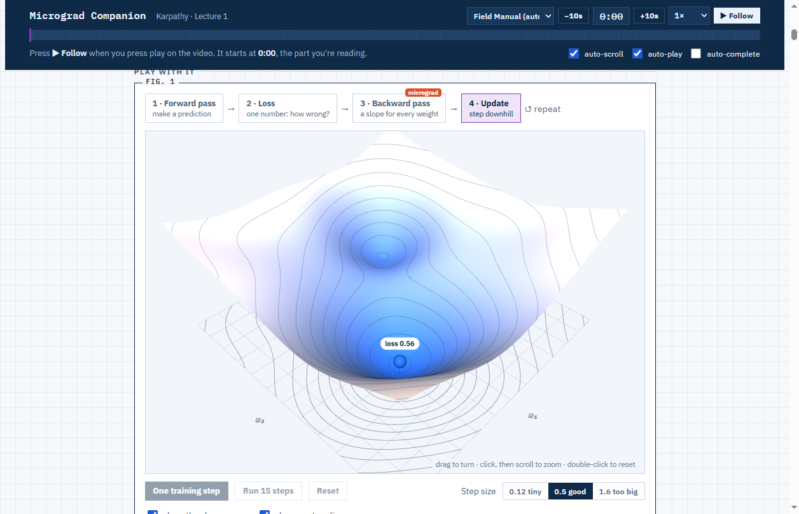
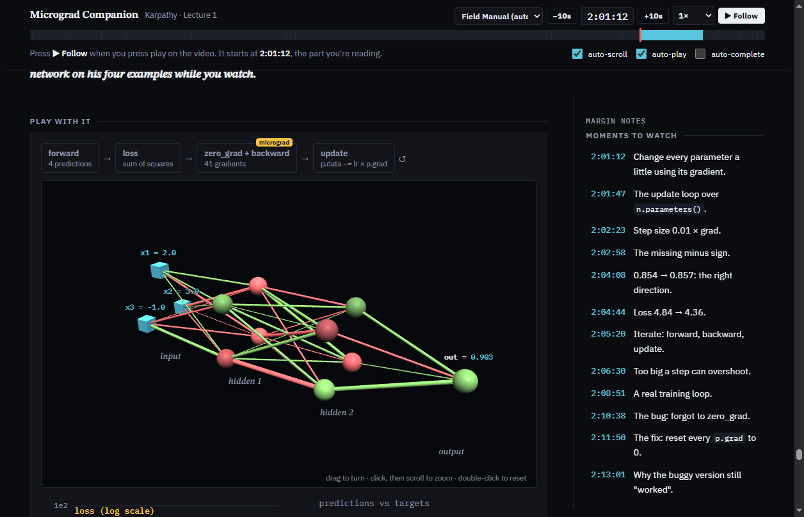

# Explorables

**Interactive companion pages for anything you're learning.** Hand Claude a lecture, a playlist,
a course, a book chapter or just a topic. Explorables builds a page you keep open beside it:

- **The same ideas in plain words,** with small numbers you can check by hand.
- **Pictures you control:** 2D plots and 3D scenes you turn, drag and change, with loops that
  start themselves.
- **Why it matters for you:** every section ties back to your own goal, which it asks about
  first.
- **Vocabulary in your language:** each new term next to the word you learned at school, if you
  learned the subject in another language.
- **A follow-along for videos:** a clock that keeps pace with the lecture. It scrolls to whatever
  the teacher is on, never while you're reading, and makes the pictures act out each moment.
- **Checks** with hidden answers, a quiz at the end, and sections you can mark done.





The reference page is [`examples/micrograd`](examples/micrograd/): a companion for Andrej
Karpathy's *The spelled-out intro to neural networks and backpropagation: building micrograd*,
with 18 sections, 21 interactive pictures and a JavaScript micrograd that trains in your browser.
Open `examples/micrograd/index.html` to try it.

## Use it

**As a Claude Code plugin:**

```
/plugin marketplace add moazessam376-dev/explorables
/plugin install explorables
```

Then ask: *"use Explorables for this lecture: <link>"*.

**Or straight from the repo:** clone it (or hand Claude the GitHub link) and say *"use
Explorables"*. [`AGENTS.md`](AGENTS.md) tells any agent where to start.

Needs Node 22+. Watching YouTube uses the bundled
[claudetube](https://github.com/moazessam376-dev/claudetube) skill, which needs Python 3, yt-dlp
and ffmpeg (it tells you how to install them if they're missing).

## What happens

1. **A few questions,** only the ones that change the page: your goal, where you're starting
   from, the language you learned the subject in, which part you're on. They're saved, so the
   next page doesn't ask again.
2. **Claude reads or watches the source,** plans the page (every section, picture, timestamp),
   builds it from a tested library, and checks it in headless Chrome and with a fresh reviewer.
3. **You get the page:** a claude.ai artifact where available, otherwise a local HTML file. For a
   course, there's also a course home with every part and your progress.
4. **When you finish a part,** tell Claude: a short out-loud quiz, the part is marked done, and
   the next page builds on what was shaky.

## Themes

Field Manual (light and dark, the default, follows your system setting), Chalkboard, Notebook
(light and dark) and Manim Night. The colours keep their meaning in every theme: a value, a
slope or gradient, the nudge, downhill or positive, negative.

## For contributors

```
npm test                                   # unit tests, build, verify (headless Chrome if installed)
node tools/build.mjs page examples/micrograd
node tools/verify.mjs examples/micrograd --screens out/
```

- `lib/`: the parts every page shares (3D stage, surfaces, 2D graphs, follow-along, themes).
- `tools/`: the build, the plan checker, the course home and the verifier.
- `skills/explorables/`: the workflow Claude follows, and its references (with the pitfalls list).
- Bugs teach the tool: every fix goes into the library, and the lesson goes into
  `skills/explorables/references/pitfalls.md`.

## Privacy

Everything stays on your machine: your profile (`~/.explorables/`), your pages and your
progress. The only exception is what you choose to publish as an artifact. Pages load three.js
from cdnjs and fonts from Google Fonts.

MIT licensed.
